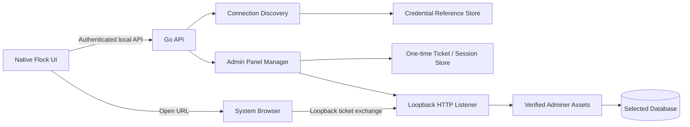

# 03 — System Architecture

## 1. Context

Flock already has a Go daemon/API and native clients for macOS, Windows and Linux. The feature should centralize discovery, credential handling, ticket issuance and local runtime lifecycle in the Go daemon. Native clients should render UI and request actions; they should not parse secrets independently or host Adminer themselves.

## 2. Logical components



## 3. Component responsibilities

### Native UI
- Display global navigation item and per-site Database block.
- Request sanitized database metadata.
- Request test/launch/stop operations.
- Invoke the OS default browser after receiving a ready launch URL.
- Never receive the database password or raw DSN in ordinary API responses.

### Go API layer
- Authenticate UI calls using existing local API auth.
- Expose database metadata, test, launch and stop endpoints.
- Validate site IDs and connection IDs against current daemon state.
- Return stable, sanitized error codes.

### Discovery service
- Parse approved config sources read-only.
- Convert source values to a normalized connection profile.
- Detect ambiguity and return candidates without silently choosing unsafe values.
- Resolve SQLite paths safely.
- Never evaluate project code or invoke shell commands.

### Credential reference store
- Resolve secret references through OS credential facilities where supported.
- Keep raw passwords out of config/status/logs.
- If current cross-platform credential-vault abstraction is unavailable, define it before enabling persistent manual profiles; do not invent a plaintext fallback.
- Short-lived in-memory secret material must be cleared as soon as practical.

### Admin Panel Manager
- Verify Adminer asset version and checksum/signature before execution/serving.
- Bind an HTTP listener to loopback only, on an ephemeral port.
- Track runtime lifecycle and idle timeout.
- Separate global launch from per-site launch.
- Issue single-use tickets and short-lived server-side sessions.
- Stop listener and invalidate all sessions on stop/shutdown.

### Browser handler
- Verify loopback peer and exact Host/Origin.
- Consume a ticket atomically.
- Establish a protected session.
- Serve Adminer and proxy only the required local asset/session routes.
- Never place DB credentials in URL or client-side JavaScript.

## 4. Proposed package boundaries

```text
internal/
  databaseadmin/
    model.go             # normalized connection/profile and safe metadata types
    discover.go          # discovery orchestration and ambiguity handling
    dotenv.go            # conservative dotenv parser
    databaseurl.go       # DATABASE_URL parsing
    sqlite.go            # SQLite path canonicalization and containment
    validate.go          # engine-specific validation
    connector.go         # bounded connection checks
    credentials.go       # credential reference interface
    ticket.go            # ticket generation/atomic consumption
    session.go           # session lifecycle and expiry
    panel.go             # Adminer runtime/listener lifecycle
    assets.go            # pinned asset metadata and integrity verification
    errors.go            # stable sanitized error taxonomy
    *_test.go            # unit and security regression tests
  api/
    databaseadminapi.go  # REST routes and DTO conversion
  daemon/
    databaseadmin.go     # daemon lifecycle integration
```

All above are proposed additions. Existing `internal/api/api.go`, `internal/daemon/daemon.go`, `internal/config/config.go` and `internal/catalog` must be inspected and extended minimally; avoid moving unrelated logic.

## 5. Request flows

### Global launch
1. UI calls authenticated `POST /v1/database-admin/global/launch`.
2. API asks manager for global intent.
3. Manager starts/reuses verified Adminer listener.
4. Manager issues short-lived opaque ticket scoped to `global`.
5. API returns loopback launch URL and expiry.
6. UI opens default browser.
7. Browser exchanges ticket and sees generic Adminer login.

### Per-site launch
1. UI calls authenticated launch endpoint with site ID and connection ID.
2. API verifies the site exists and connection belongs to it.
3. Discovery/profile resolver obtains credential reference server-side.
4. Manager performs bounded DB connectivity check.
5. Manager starts/reuses Adminer listener and creates a ticket scoped to site + connection.
6. Browser exchanges ticket; server-side session binds the selected connection.
7. Adminer receives connection details server-side only; credentials are never encoded in URL/HTML/JS.
8. User is taken to the selected DB context.

### Test connection
- API resolves selected connection.
- Connector applies timeout and TLS policy.
- Return success, latency bucket and sanitized error code only.
- Never include driver error text if it could contain DSN/password.

## 6. Adminer integration decision

Adminer is a PHP application. Flock must choose and document one supported serving strategy before implementation:
- Preferred: package a pinned Adminer artifact and serve it through an already supported local PHP runtime only if this can be isolated safely; or
- A dedicated embedded runtime if dependency footprint and platform packaging are acceptable.

Do not assume a PHP runtime exists just because the host has PHP installed. Do not execute arbitrary downloaded files. The Adminer integration must be verified with integration tests on all supported OSes.

The exact approach is an implementation gate, not a guessed detail. Prototype packaging/runtime feasibility before locking the final dependency strategy.

## 7. Platform integration

- macOS: SwiftUI view model and FlockKit client model; use platform URL-opening API.
- Windows: Flock.Kit DTO/client and existing UI view model/commands; use OS browser launcher.
- Linux: Rust API DTO/client and pane/view; use desktop URL opener through the existing application abstraction.
- All clients must consume the same API contract and show equivalent states.

## 8. Runtime lifecycle

States: `stopped → starting → ready → stopping → stopped`, with `failed` reachable from starting/ready.

- Startup is idempotent.
- Listener binds before URL is returned.
- Shutdown closes listener, clears ticket/session stores and terminates owned child processes.
- Idle timeout invalidates sessions and shuts down the listener when no active session remains.
- Global and site sessions are distinct and must not inherit each other's selected connection context.
